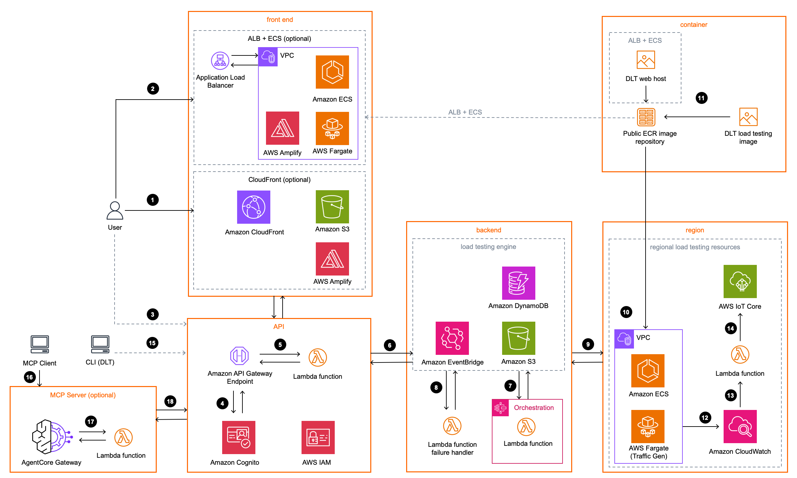

# Distributed Load Testing on AWS

Distributed Load Testing on AWS helps you automate performance testing of your software applications at scale to identify bottlenecks before you release your application. This solution simulates thousands of connected users generating HTTP requests at a sustained rate without the need to provision servers.

- Deploy Amazon ECS on AWS Fargate containers that run independently to test the load capacity of your application.
- Simulate tens of thousands of concurrent users across multiple AWS Regions generating requests at a continuous pace.
- Customize your application tests using [JMeter](https://jmeter.apache.org/), [K6](https://k6.io/), [Locust](https://locust.io/) test scripts, or simple HTTP endpoint configuration.
- Schedule load tests to run immediately, at a future date and time, or on a recurring schedule.
- Run multiple load tests concurrently across different scenarios and regions.

The intended audience for using this solution's features and capabilities in their environment includes IT infrastructure architects, administrators, and DevOps professionals who have practical experience architecting in the AWS Cloud. As a result, developers can understand the behavior of their applications at scale and at load to identify any bottleneck problems before they deploy to Production. [Launch in the AWS Console](https://console.aws.amazon.com/cloudformation/home?region=us-east-1#/stacks/new?&templateURL=https://solutions-reference.s3.amazonaws.com/distributed-load-testing-on-aws/latest/distributed-load-testing-on-aws.template&redirectId=GitHub)

## On this Page

- [Public Roadmap](#public-roadmap)
- [Architecture Overview](#architecture-overview)
- [Traffic shape: Standard and Native](#traffic-shape-standard-and-native)
- [Deployment](#deployment)
- [Source Code](#source-code)
- [Local Development](#local-development)
- [Testing](#testing)
- [Creating a custom build](#creating-a-custom-build)
- [Creating a custom container build](#creating-a-custom-container-build)
- [Third-party testing frameworks](#third-party-testing-frameworks)
- [Collection of operational metrics](#collection-of-operational-metrics)

## Public Roadmap

See what we're building next on the [DLT Roadmap board](https://github.com/orgs/aws-solutions/projects/29/views/1).

We welcome community input:

- **Vote** — add a 👍 reaction to roadmap issues that matter to you
- **Discuss** — comment on roadmap issues with your use case or feedback
- **Propose** — open a [Feature Request](https://github.com/aws-solutions/distributed-load-testing-on-aws/issues/new?template=feature_request.md) for capabilities you'd like to see

The roadmap is not a commitment to deliver features by specific dates. Priorities may shift based on community feedback, security requirements, and operational needs.

## Architecture Overview



Deploying this solution with the default parameters deploys the following components in your AWS account.

> **Note**: AWS CloudFormation resources are created from AWS Cloud Development Kit (AWS CDK) constructs.

The high-level process flow for the solution components deployed with the AWS CloudFormation template is as follows:

1. _(CloudFront + S3 hosting option)_ The console user accesses the web console through [Amazon CloudFront](https://aws.amazon.com/cloudfront), which serves the [AWS Amplify](https://aws.amazon.com/amplify) application hosted in an [Amazon Simple Storage Service](https://aws.amazon.com/s3) (Amazon S3) bucket.

2. _(ALB + ECS Fargate hosting option)_ The console user accesses the web console through an [Application Load Balancer](https://aws.amazon.com/elasticloadbalancing/application-load-balancer/), which routes traffic to the Amplify application running on [Amazon Elastic Container Service](https://aws.amazon.com/ecs) (Amazon ECS) on [AWS Fargate](https://aws.amazon.com/fargate) inside an [Amazon Virtual Private Cloud](https://aws.amazon.com/vpc) (Amazon VPC).

3. _(Headless hosting option)_ No public front end is deployed. The solution provides the web console as a downloadable ZIP archive in a private S3 bucket, which the console user can serve from a self-hosted web server.

4. During initial configuration, the solution creates a default administrator user in the [Amazon Cognito](https://aws.amazon.com/cognito) user pool and sends an account creation email to the address you provide. The Cognito user pool manages user access to the web console, the REST API, the CLI, and the MCP Server.

5. [Amazon API Gateway](https://aws.amazon.com/api-gateway) invokes [AWS Lambda](https://aws.amazon.com/lambda) microservices that provide the business logic to manage test data and run the tests.

6. The microservices interact with Amazon S3, [Amazon DynamoDB](https://aws.amazon.com/dynamodb), and [Amazon EventBridge](https://aws.amazon.com/eventbridge) to store test scenario details and manage test schedules. When you schedule a test to run at a future time or on a recurring interval, the microservices create an EventBridge Scheduler schedule that invokes the microservice at the scheduled time.

7. To run a test, the microservices invoke [AWS Step Functions](https://aws.amazon.com/step-functions), which orchestrates the test execution.

8. EventBridge rules route Amazon ECS task failure events and Step Functions failure events to a failure handler Lambda function.

9. Step Functions creates an ephemeral Amazon ECS service on AWS Fargate in each AWS Region you selected, which launches the test tasks for that Region.

10. Each task runs within an Amazon VPC in the selected Region.

11. The load testing containers use an [Amazon Linux 2023](https://aws.amazon.com/linux/amazon-linux-2023/) base image, and which engine runs a given test depends on its traffic-shape mode. Standard mode runs the test through the [Taurus](https://gettaurus.org/) test automation framework, which drives JMeter, k6, Locust, or a Simple HTTP Endpoint test. Native mode runs your uploaded script under the framework's own command line in a per-framework image that does not include Taurus. See [Traffic shape: Standard and Native](#traffic-shape-standard-and-native) below. The container images are hosted by AWS in an [Amazon Elastic Container Registry](https://aws.amazon.com/ecr) (Amazon ECR) public repository. For more information, refer to [Container image customization](https://docs.aws.amazon.com/solutions/latest/distributed-load-testing-on-aws/container-image.html).

12. Each Fargate task writes its per-Region test results to Amazon S3 and emits logs to [Amazon CloudWatch](https://aws.amazon.com/cloudwatch). When all Regions complete, the microservices aggregate the results in DynamoDB.

13. If you enable the live data option, a Lambda function receives CloudWatch logs from the Fargate tasks during the test.

14. The Lambda function publishes the logs to a topic in [AWS IoT Core](https://aws.amazon.com/iot-core) in the Region where the main stack was deployed. The web console subscribes to the topic to display real-time metrics while the test runs.

15. _(Optional CLI access)_ You can install the DLT command-line interface locally to interact with the solution from a terminal. The CLI authenticates through Cognito and calls the REST API directly, which enables scripted automation and CI/CD integration. See [source/cli/README.md](source/cli/README.md).

### MCP Server Integration (Optional)

> **Note**: The following steps describe the optional MCP Server integration for AI-assisted load testing analysis. This component is only deployed if you select the MCP Server option during solution deployment.

16. An MCP client (AI development tool) connects to the [Amazon Bedrock AgentCore Gateway](https://aws.amazon.com/bedrock/agentcore/) endpoint to access the solution's data through the Model Context Protocol. AgentCore Gateway validates the user's Cognito authentication token to ensure authorized access to the MCP Server.

17. Upon successful authentication, AgentCore Gateway forwards the MCP tool request to the DLT MCP Server Lambda function.

18. The Lambda function calls the DLT REST API to retrieve the requested load testing data, and reads from or writes to the scenarios S3 bucket for test script uploads and result artifacts. It then returns the structured data to AgentCore Gateway, which sends it back to the MCP client for AI-assisted analysis and insights.

## Traffic shape: Standard and Native

Every test scenario runs in one of two traffic-shape modes, which decide whether the solution or your script controls the load. Standard is the default and is what every test used before v4.3.0, so existing scenarios keep behaving exactly as they did.

**Standard.** Standard mode puts DLT in control of the load. You set the Fargate task count per Region, the concurrent virtual users per task, a ramp-up period, and a hold duration, and DLT runs the test through the Taurus automation framework, which applies those values over whatever load your script declares. A Region's virtual users are the task count multiplied by the per-task concurrency. Standard is the only mode that lets you set an exact virtual-user count and change the ramp-up and hold shape without editing the script, and the only one that supports the Simple HTTP Endpoint type. Its limit is expressiveness: anything Taurus cannot represent, such as weighted scenarios, per-stage thresholds, or arrival-rate executors, is unavailable.

**Native.** Native mode puts your script in control of the load. DLT runs the file you uploaded under the framework's own command line and passes no load flags, so your script is the sole authority on the traffic it generates. Two controls remain: how many Fargate tasks to launch per Region, and a required safety duration of up to 24 hours. The safety duration guards against a script that never exits rather than scheduling the run: if the test is still going when it elapses, DLT stops the framework, keeps the results for the portion that ran, and records the run as completed. Tasks are uncoordinated and each runs a full copy of the script, so a k6 script holding 200 virtual users on five tasks puts 1,000 virtual users on the target. Task count is therefore the only load dial; changing the ramp, the hold time, or the virtual-user count means editing the script. Native requires an uploaded script, so Simple HTTP Endpoint is unavailable, and Locust scripts must not set processes.

| If you need                                                    | Use      |
| -------------------------------------------------------------- | -------- |
| An exact virtual-user count, set from outside the script       | Standard |
| To change the ramp-up or hold time without editing the script  | Standard |
| A single URL with no script at all                             | Standard |
| The same load shape regardless of framework                    | Standard |
| To reuse a CI or local script unchanged                        | Native   |
| The script's own stages, thresholds, or shape honored          | Native   |
| k6 scenarios, thresholds, or arrival-rate executors            | Native   |
| A Locust `LoadTestShape` or weighted task set                  | Native   |
| JMeter timers and thread groups run exactly as authored        | Native   |
| To scale load only in whole multiples of the script's own load | Native   |

Both modes report the same metrics, stream live data to the console during a run, and scale by adding tasks, so results stay comparable across a mode switch. Select the mode on the Traffic shape step of the create form, with `--native-mode` in the [DLT CLI](source/cli/README.md), or with `native_run_mode` through the [MCP server](source/mcp-server/README.md).

## Deployment

The solution provides three deployment templates to suit different hosting requirements:

| Template                  | Description                                                                                                                             |
| ------------------------- | --------------------------------------------------------------------------------------------------------------------------------------- |
| Default (CloudFront + S3) | Web console served via CloudFront and S3. Suitable for most regions.                                                                    |
| ALB + ECS                 | Web console hosted behind an Application Load Balancer with ECS Fargate. For regions without CloudFront or secure network requirements. |
| Headless                  | No web console hosting. Backend services only, with console assets in S3 for self-hosting.                                              |

The solution can be deployed using either CloudFormation or AWS CDK:

**CloudFormation Deployment**: The solution is deployed using a CloudFormation template. To simulate users from regions other than the region the solution is initially deployed in, a regional template must be deployed within the other desired regions. For details on deploying the solution, see the [implementation guide](https://docs.aws.amazon.com/solutions/latest/distributed-load-testing-on-aws/deploy-the-solution.html).

**AWS CDK Deployment**: For custom deployments and direct infrastructure-as-code management, the solution's infrastructure is developed with AWS CDK v2. See the [infrastructure README](source/infrastructure/README.md) for detailed CDK deployment instructions including prerequisites, bootstrapping, and deployment of all stack variants.

## Source Code

**source/api-services**<br/>
A TypeScript Lambda function for the API microservices. Integrated with Amazon API Gateway, used to manage test scenarios and test runs.

**source/cli**<br/>
A TypeScript command-line interface for headless interaction with the DLT solution. Supports three authentication modes (browser OAuth/PKCE, SRP headless, and IAM), and provides commands to manage test scenarios, query run results, download artifacts from S3, and inspect token status. Designed for both interactive developer use and CI/CD integration. See [source/cli/README.md](source/cli/README.md) for full documentation.

**source/common**<br/>
A TypeScript library of shared utilities, types, and validation schemas imported by the other TypeScript packages in the solution.

**source/custom-resource**<br/>
A NodeJS Lambda function used as a CloudFormation custom resource for sending operational metrics to AWS, configuration for regional testing infrastructure, and iot configuration.

**source/infrastructure**<br/>
A Typescript [AWS Cloud Development Kit (AWS CDK)](https://aws.amazon.com/cdk/) [v2](https://docs.aws.amazon.com/cdk/v2/guide/home.html) package that defines the infrastructure resources to run the Distributed Load Testing on AWS solution. It defines all stack variants (default, ALB + ECS, headless, and regional) and hosts a small number of inline Lambda functions under `source/infrastructure/lambda`.

It also uses the [AWS Solutions Constructs](https://aws.amazon.com/solutions/constructs/) [aws-cloudfront-s3](https://docs.aws.amazon.com/solutions/latest/constructs/aws_cloudfront_s3.html) package to define the CloudFront distribution and the S3 bucket that stores the content that makes up the UI.

**source/load-tester**<br/>
A TypeScript package containing the container entrypoints and runners for the per-framework load testing images. The entrypoints under `src/entrypoints` are bundled into the Docker build contexts in `deployment/ecr` at build time.

**source/mcp-server**<br/>
A TypeScript package that implements the Model Context Protocol (MCP) server for AI-assisted load testing analysis. Provides structured access to DLT data through Amazon Bedrock AgentCore Gateway. See [source/mcp-server/README.md](source/mcp-server/README.md).

**source/metrics-utils**<br/>
A TypeScript package that provides the operational metrics CDK construct and its supporting Lambda functions, used by the main and regional stacks.

**source/orphan-cleanup**<br/>
A TypeScript Lambda function that runs on an hourly schedule to detect and delete leaked ECS services that have no active Step Functions execution, which prevents ongoing Fargate charges.

**source/real-time-data-publisher**<br/>
A NodeJS Lambda function used to publish the real time load test data to an IoT topic.

**source/regional-sync**<br/>
A TypeScript Lambda function that validates every selected Region is ready before test execution begins, so a multi-Region test starts in sync.

**source/results-parser**<br/>
A NodeJS Lambda function used to write the xml output from the docker images to Amazon DynamoDB and generate the final results for each test.

**source/sfn-failure-handler**<br/>
A TypeScript Lambda function triggered by EventBridge when the orchestration state machine exits without success. It acts as a secondary safety net that cleans up ECS resources the state machine did not.

**source/solution-utils**<br/>
A NodeJS package that contains commonly used functionality that is imported by other packages in this solution.

**source/stabilization-checker**<br/>
A TypeScript Lambda function that polls ECS service health and resolves task IP addresses while the state machine waits for a Region's tasks to become stable.

**source/start-command**<br/>
A TypeScript Lambda function that writes the S3 start markers that release the waiting tasks in each Region, so all Regions begin generating load together.

**source/task-canceler**<br/>
A TypeScript Lambda function that coordinates test cancellation. Invoked by the API, it marks the test as cancelling, stops the running state machine execution, and invokes test-cleanup for each Region.

**source/task-failure-handler**<br/>
A TypeScript Lambda function that detects ECS task failures through EventBridge and updates the test status in DynamoDB.

**source/task-runner**<br/>
A TypeScript Lambda function that creates the ephemeral ECS service and task definition for a test in one Region.

**source/task-status-checker**<br/>
A TypeScript Lambda function with two roles in the state machine: it checks whether a test is already running before a new run starts, and it polls S3 completion markers and DynamoDB status to detect when a running test has finished.

**source/test-cleanup**<br/>
A TypeScript Lambda function that tears down the ECS resources for one Region and records the final test status. Invoked on both the success and failure paths of the state machine and by task-canceler.

**source/test-metadata-updater**<br/>
A TypeScript Lambda function that updates the scenario and history DynamoDB tables as a test moves through its lifecycle, guarding against overwriting terminal states.

**source/webui**<br/>
React-based single page application that provides the web console interface for the solution. Built with Vite, Cloudscape Design System, Redux Toolkit for state management, and AWS Amplify for authentication. Authenticated through Amazon Cognito, this dashboard allows users to create tests and view results.

## Local Development

For developers working on the solution locally, this section provides step-by-step instructions for setting up and deploying DLT from source code.

### Prerequisites

- Node.js 24.x or later
- AWS CLI configured with appropriate credentials
- Docker (for container image builds)

### Environment Setup

1. **Create environment configuration**:

   ```bash
   cp .env.example .env
   ```

2. **Configure your `.env` file** with your specific values:

   ```bash
   # CDK Parameters
   TARGET_REGION=us-west-2                    # Your primary deployment region

   # Stack name selects the deployment mode: the default CloudFront stack,
   # distributed-load-testing-on-aws-alb-ecs, or distributed-load-testing-on-aws-headless
   MAIN_STACK_NAME=distributed-load-testing-on-aws
   REGIONAL_STACK_NAME=distributed-load-testing-on-aws-regional

   # Stack Parameters
   ADMIN_NAME=your_username                   # Admin username (no spaces)
   ADMIN_EMAIL=your-email@example.com         # Admin email address

   # Optional
   STACK_TAGS=                                # Space-separated key=value tags for cdk deploy
   REGIONAL_STACKS=                           # Space-separated regions for make regional-deploy
   ```

   The ALB + ECS stack also requires `CONSOLE_DOMAIN_NAME` and `ACM_CERTIFICATE_ARN`. See `.env.example` for the full annotated list.

### Deploying from Source

1. **Install dependencies**:

   ```bash
   make install-deps
   ```

2. **Deploy the main stack**:

   ```bash
   make deploy
   ```

   > **Note**: This automatically builds the web and JMeter assets and synthesizes the regional template before deploying.

3. **Add regional testing capacity** (optional):

   ```bash
   make regional-deploy REGION=us-west-2
   ```

4. **Run the web app locally** against the deployed stack:

   ```bash
   make dev
   ```

   `make dev` resolves the console bucket from the stack outputs and fetches `aws-exports.json` before starting the Vite dev server, so the main stack must already be deployed.

### Regional Stack Management

To enable load testing from multiple regions, you can deploy regional stacks that contain the testing infrastructure (ECS clusters, VPC, etc.). The `regional-deploy` target automatically bootstraps CDK in the target region if needed.

1. **Deploy to a single region**:

   ```bash
   make regional-deploy REGION=us-west-2
   ```

2. **Deploy to several regions at once** by listing them in `REGIONAL_STACKS` in `.env` and omitting `REGION`:

   ```bash
   # .env: REGIONAL_STACKS=us-west-2 eu-west-1 ap-southeast-1
   make regional-deploy
   ```

### Regional Stack Version Compatibility

The hub stack validates that each regional (spoke) stack is running a compatible version before allowing a test to proceed. Two rules are enforced:

1. The regional stack version must be greater than or equal to the minimum compatible version declared in `regional-compatibility.json`.
2. The regional stack version must be less than or equal to the hub stack version. This enforces a hub-first upgrade order since the hub builds the regional CloudFormation template.

If a test targets an incompatible region, the API rejects the request with a descriptive error and writes a failed test run to the history table so the failure is visible in the web console.

**When to bump `minimumCompatibleVersion`**: Update the `minimumCompatibleVersion` field in `regional-compatibility.json` when a release introduces a change that requires redeployment of regional stacks. Examples include changes to the ECS task definition, the container image or `load-test.sh` entrypoint, ECS cluster configuration, networking resources, or the DynamoDB schema written by the regional custom resource.

**How to bump**: Edit `regional-compatibility.json` at the repo root and set `minimumCompatibleVersion` to the version that introduces the breaking change.

```json
{
  "minimumCompatibleVersion": "4.3.0"
}
```

**Upgrade order**: Always deploy the hub stack first (or simultaneously with regional stacks). The hub generates the regional CloudFormation template, so regional stacks deployed after a hub upgrade will use the latest template. Existing regional stacks must be redeployed to pick up the changes.

### Available Make Targets

- `make help` - Show available commands and usage information
- `make install-deps` - Install all project dependencies
- `make dev` - Run web UI locally (requires deployed stack)
- `make deploy` - Deploy the main DLT stack (builds web and JMeter assets automatically)
- `make diff` - Preview stack changes before deployment
- `make changeset` - Create CloudFormation changeset for review
- `make regional-deploy` - Deploy regional stacks to every region listed in `REGIONAL_STACKS`
- `make regional-deploy REGION=<region>` - Deploy a regional stack to one region (auto-bootstraps CDK in the target region)
- `make test` - Run all unit tests, linting, and formatting checks (the same checks as CI)
- `make sync` - Fix auto-fixable workspace dependency version mismatches
- `make bundle-cli` - Bundle the DLT CLI into a single portable file
- `make worktree-add` - Create a dev worktree on a new branch, copying `.env` and installing dependencies
- `make worktree-remove` - Remove a dev worktree

### Notes

- Regional stacks automatically register themselves with the main stack and will appear in the web console
- Each regional stack creates independent testing infrastructure in the specified region
- The main stack must be deployed before any regional stacks
- Regional stacks can be deployed to the same region as the main stack or different regions

## Testing

**Unit tests, lint, and format checks**: the `test` target runs the same checks as CI.

```bash
make test
```

To run the underlying script directly, including dependency installation:

```bash
cd deployment
chmod +x ./run-unit-tests.sh
./run-unit-tests.sh
```

## Creating a custom build

The solution can be deployed through the CloudFormation template available on the solution home page: [Distributed Load Testing on AWS](https://docs.aws.amazon.com/solutions/distributed-load-testing-on-aws/).

To make changes to the solution, download or clone this repository, update the source code and then run the deployment/build-s3-dist.sh script to deploy the updated Lambda code to an Amazon S3 bucket in your account.

### Prerequisites

- Node.js 24.x or later
- S3 bucket that includes the AWS region as a suffix in the name. For example, `my-bucket-us-east-1`. The bucket and CloudFormation stack must be in the same region. The solution's CloudFormation template will expect the source code to be located in a bucket matching that name.

### Running unit tests for customization

- Clone the repository and make the desired code changes.

```bash
git clone https://github.com/aws-solutions/distributed-load-testing-on-aws.git
cd distributed-load-testing-on-aws
export BASE_DIRECTORY=$PWD
```

- Run unit tests to make sure the updates pass the tests.

```bash
cd $BASE_DIRECTORY/deployment
chmod +x ./run-unit-tests.sh
./run-unit-tests.sh
```

### Building distributable for customization

- Configure the environment variables.

```bash
export REGION=aws-region-code # the AWS region to launch the solution (e.g. us-east-1)
export BUCKET_PREFIX=my-bucket-name # prefix of the bucket name without the region code
export BUCKET_NAME=$BUCKET_PREFIX-$REGION # full bucket name where the code will reside
export SOLUTION_NAME=my-solution-name
export VERSION=my-version # version number for the customized code (must contain a valid semver, e.g. v4.3.0 or custom-v4.3.0)
export PUBLIC_ECR_REGISTRY=public.ecr.aws/aws-solutions # replace with the container registry and image if you want to use a different container image
export PUBLIC_ECR_TAG=v4.3_stable # replace with the container image tag if you want to use a different container image
```

- Build the distributable.

```bash
cd $BASE_DIRECTORY/deployment
chmod +x ./build-s3-dist.sh
./build-s3-dist.sh $BUCKET_PREFIX $SOLUTION_NAME $VERSION
```

> **Note**: The _build-s3-dist_ script expects the bucket name **without the region suffix** as one of its parameters.

> **Note**: The `VERSION` parameter must contain a valid semantic version pattern (`MAJOR.MINOR.PATCH`, e.g. `v4.3.0`, `custom-v4.3.0`, or `v4.3.0-ITL`). The script will reject values that don't match this format and warn if the version doesn't align with the `solutionVersion` in `source/infrastructure/cdk.json`.

- Deploy the distributable to the Amazon S3 bucket in your account.
  - Make sure you are uploading the files in `deployment/global-s3-assets` and `deployment/regional-s3-assets` to `$BUCKET_NAME/$SOLUTION_NAME/$VERSION`.

- Get the link of the solution template uploaded to your Amazon S3 bucket.

- Deploy the solution to your account by launching a new AWS CloudFormation stack using the link of the solution template in Amazon S3.

## Creating a custom container build

This solution uses a public Amazon Elastic Container Registry (Amazon ECR) image repository managed by AWS to store the solution container image that is used to run the configured tests. If you want to customize the container image, you can rebuild and push the image into an ECR image repository in your own AWS account.
For details on how to customize the container image, please see the **Container image customization** section of the [implementation guide](https://docs.aws.amazon.com/solutions/latest/distributed-load-testing-on-aws/container-image.html).

## Third-party testing frameworks

This solution includes [Apache JMeter](https://jmeter.apache.org/) 5.6.3 as one of its supported load testing engines. JMeter 5.6.3 has known security vulnerabilities that cannot be fully patched externally due to compatibility constraints with the Taurus test automation framework. DLT distributes JMeter without modification.

Customers are responsible for evaluating whether JMeter 5.6.3 meets their security requirements. You can supply a patched JMeter binary in your test archive or replace individual plugin JARs using the plugin override mechanism. See [docs/jmeter.md](docs/jmeter.md) for details on security considerations and patching options, and the [Apache JMeter security page](https://jmeter.apache.org/security.html) for current advisories.

## Collection of operational metrics

This solution sends operational metrics to AWS (the “Data”) about the use of this solution. We use this Data to better understand how customers use this solution and related services and products. AWS’s collection of this Data is subject to the [AWS Privacy Notice](https://aws.amazon.com/privacy/).

---

Copyright Amazon.com, Inc. or its affiliates. All Rights Reserved.<br />
SPDX-License-Identifier: Apache-2.0
